# ⚡ HackX — Full-Stack College Hackathon Operations Engine

> A production-ready, reusable **College Hackathon Website, Event CMS & Operations Platform** built with **Next.js 14 (App Router)**, **TypeScript 5**, **Tailwind CSS**, **GSAP 3 + Framer Motion**, and **MongoDB (Mongoose 8)**.

[](https://nextjs.org/)
[](https://www.typescriptlang.org/)
[](https://tailwindcss.com/)
[](https://greensock.com/gsap/)
[](https://www.framer.com/motion/)
[](https://www.mongodb.com/atlas)
[](https://github.com/panva/jose)
[](https://opensource.org/licenses/MIT)

**Live Production Deployment**: [https://marvelzhack.vercel.app](https://marvelzhack.vercel.app)

---

## 📑 Table of Contents

- [Overview & Blueprint Design System](#-overview--blueprint-design-system)
- [System Architecture & Data Flow](#-system-architecture--data-flow)
- [Key Core Workflows](#-key-core-workflows)
  - [1. Student Registration & Thermal Receipt QR Pass Flow](#1-student-registration--thermal-receipt-qr-pass-flow)
  - [2. Desk Check-In & Gate Attendance Flow](#2-desk-check-in--gate-attendance-flow)
  - [3. Organizer Staff Lifecycle & RBAC Masking](#3-organizer-staff-lifecycle--rbac-masking)
  - [4. Multi-Edition Event Management Lifecycle](#4-multi-edition-event-management-lifecycle)
- [Comprehensive Page-by-Page Deep Dive](#-comprehensive-page-by-page-deep-dive)
  - [1. Public Landing Page (`/`)](#1-public-landing-page-)
  - [2. Student Registration (`/register`)](#2-student-registration-register)
  - [3. Thermal Receipt Printer QR Pass (`/register/success/[teamId]`)](#3-thermal-receipt-printer-qr-pass-registersuccessteamid)
  - [4. Pass Retrieval & Lookup (`/find-registration`)](#4-pass-retrieval--lookup-find-registration)
  - [5. Camera QR Check-In Desk (`/checkin`)](#5-camera-qr-check-in-desk-checkin)
  - [6. Live Auditorium & Stage Display (`/live`)](#6-live-auditorium--stage-display-live)
  - [7. Organizer Staff Portal (`/organizer/*`)](#7-organizer-staff-portal-organizer)
  - [8. Master Admin Operations Engine (`/admin/*`)](#8-master-admin-operations-engine-admin)
- [Role-Based Access Control (RBAC) Matrix](#-role-based-access-control-rbac-matrix)
- [Technical Stack & Zero-Cost Serverless Setup](#-technical-stack--zero-cost-serverless-setup)
- [Project Directory Structure](#-project-directory-structure)
- [Getting Started & Local Setup](#-getting-started--local-setup)
- [Administrator Enrollment Runbook](#-administrator-enrollment-runbook)
- [Zero-Cost Production Deployment (Vercel & MongoDB Atlas)](#-zero-cost-production-deployment-vercel--mongodb-atlas)
- [License & Author](#-license--author)

---

## 📐 Overview & Blueprint Design System

HackX was engineered to eliminate chaotic Google Forms, lost WhatsApp PDFs, and disconnected event tools during high-stakes student hackathons. It bundles participant registration, hardware-inspired QR entry badges, gate attendance scanners, a synchronized stage countdown, and a master CMS into one cohesive platform.

The UI is built with an **Architectural Blueprint CAD Aesthetic**:
- **Palette**: Deep Blueprint Navy (`#0B1F3A`), Drafting Yellow (`#FFD23F`), Off-White Paper (`#F2EFE6`), and Translucent Technical Cyan accents.
- **Canvas**: Interactive, hardware-accelerated 48px graph-paper canvas backdrop with crosshair coordinate calipers and technical spec readouts.
- **Tactile Physics**: Skeuomorphic hardware thermal receipt printer with stepped micro-motion, 40-tooth serrated paper edges, mechanical 3D flip-clock countdown, and hover-triggered technical text scrambling.
- **Zero-Cost Serverless Core**: Fully runs on free-tier infrastructure (Vercel Hobby, MongoDB Atlas M0, Cloudinary Free Tier, and native RFC 6238 TOTP authentication).

---

## 🏛️ System Architecture & Data Flow

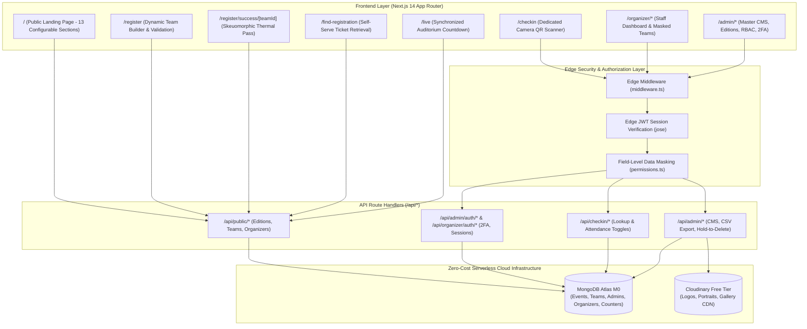

---

## 🔄 Key Core Workflows

### 1. Student Registration & Thermal Receipt QR Pass Flow

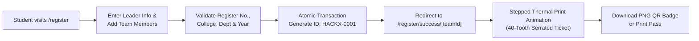

### 2. Desk Check-In & Gate Attendance Flow

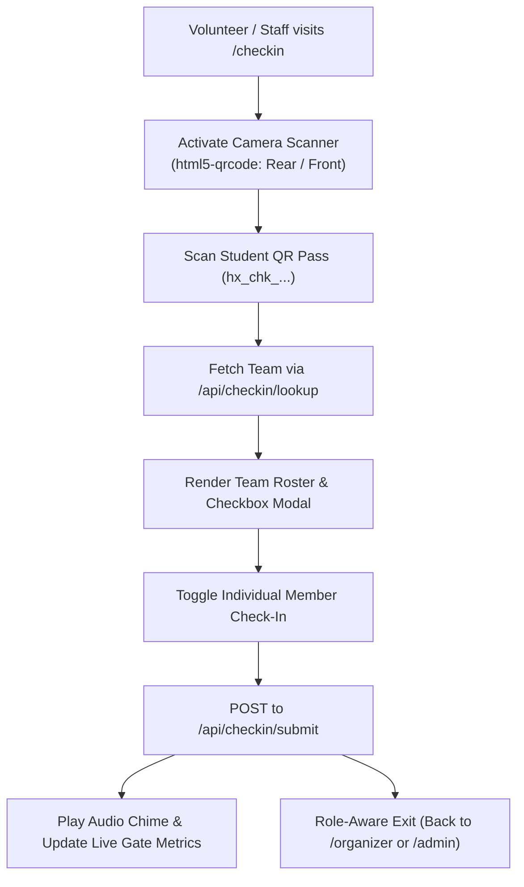

### 3. Organizer Staff Lifecycle & RBAC Masking

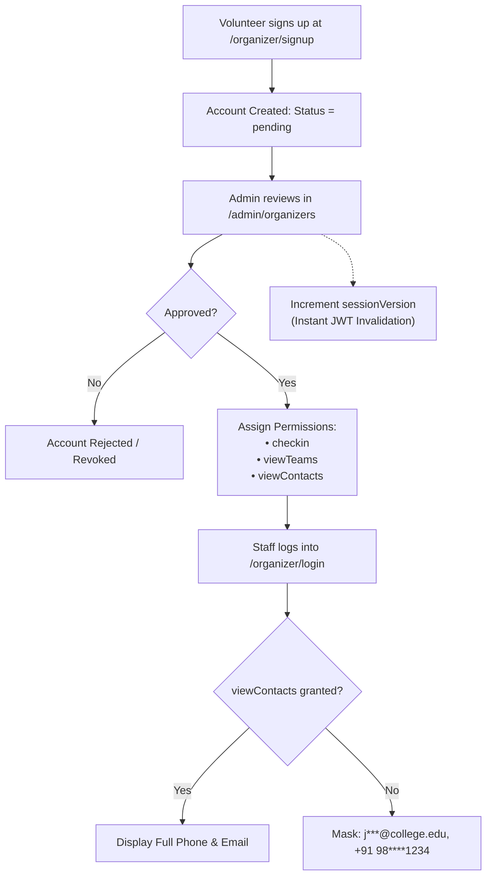

### 4. Multi-Edition Event Management Lifecycle

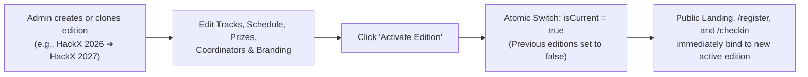

---

## 🖥️ Comprehensive Page-by-Page Deep Dive

### 1. Public Landing Page (`/`)

The public face of the hackathon. A dynamic, server-rendered landing page with 13 modular sections that can be individually reordered, edited, or toggled on/off in real time from the Admin Panel.

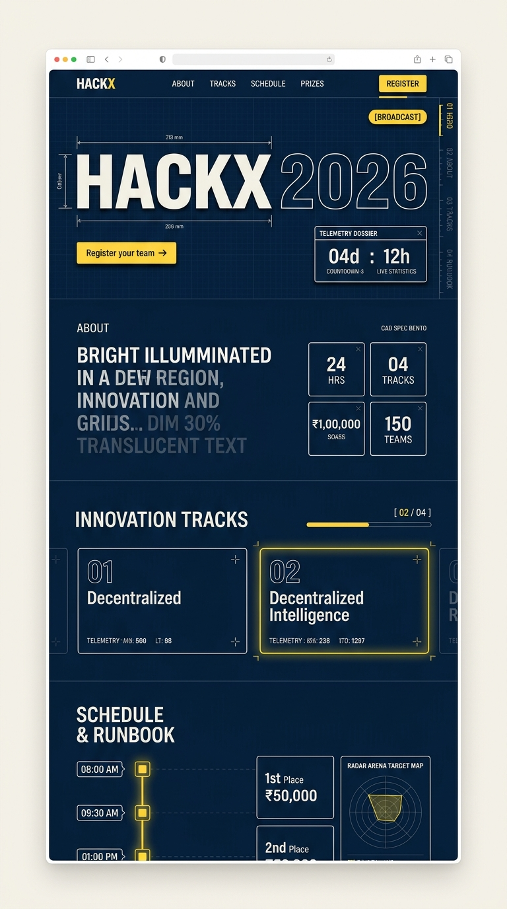

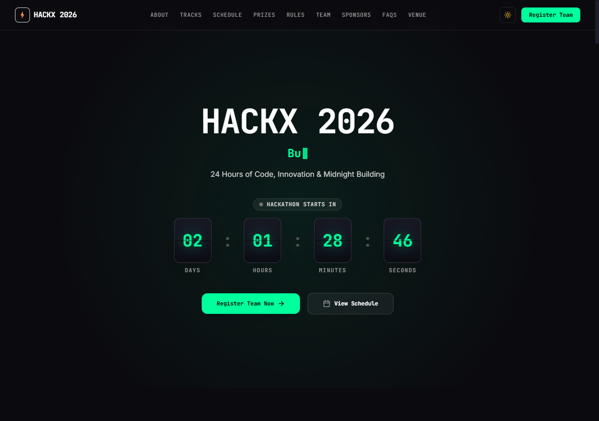

- **Route**: [`/`](file:///d:/TEC/college/hackathon/app/page.tsx)
- **Access Level**: Public (No authentication required)
- **Components & Highlights**:
  - **Hero Section (`Hero.tsx`)**: Technical CAD callout with `ScrambleText` on mount/hover, split text typography with `.text-outline` year styling, dimension calipers, and live server telemetry feed.
  - **About Section (`About.tsx`)**: Word-by-word scrubbed `SplitText` headline paired with a `2×2` CAD Spec Bento Grid (`DURATION: 24H`, `DOMAINS: 6`, `PRIZE POOL: ₹1,00,000+`, `CAPACITY: 50 TEAMS`).
  - **Tracks Section (`Tracks.tsx`)**: Hackathon track blueprints with hover text scrambling, icon badges, and problem statements.
  - **Schedule Timeline (`Schedule.tsx`)**: Continuous scrubbed vertical yellow drafting spine illuminating milestone nodes as the user scrolls.
  - **Prizes Section (`Prizes.tsx`)**: Staggered podium cards with cash breakdowns, trophy CAD icons, and sponsor tracks.
  - **Coordinators (`Coordinators.tsx`) & Operations Leads (`Organizers.tsx`)**: Faculty directors and student leads featuring category filters (`All`, `Faculty`, `Student`) and monochrome-to-color portrait hover transitions.
  - **Sponsors (`Sponsors.tsx`) & Gallery (`Gallery.tsx`)**: Configurable sponsor grid and a keyboard-accessible photo contact sheet with modal lightbox.
  - **FAQ Section (`Faq.tsx`)**: Interactive accordion synchronized with `ScrollTrigger.refresh()`.
  - **Announcement Marquee (`AnnouncementTicker.tsx`)**: Live broadcast ribbon with visible WCAG 2.2.2 Pause/Play control.
  - **Blueprint Canvas Background (`BlueprintBackground.tsx`)**: Lightweight 48px drafting grid with crosshairs and cursor tracking.

---

### 2. Student Registration (`/register`)

A battle-tested team registration portal enforcing dynamic constraints set by the active hackathon edition.

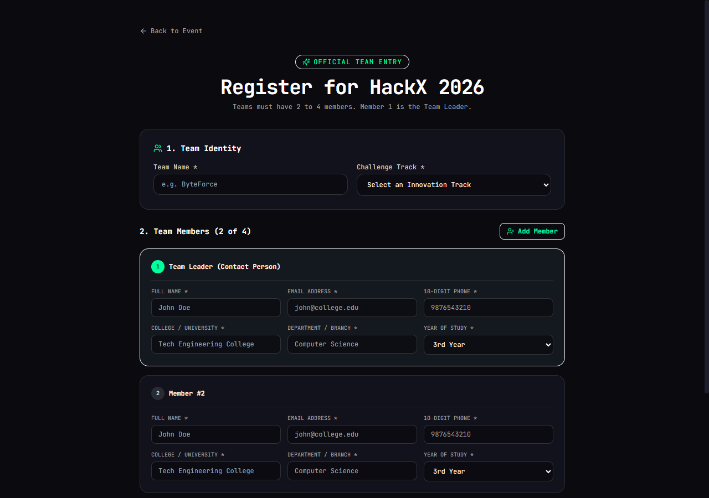

- **Route**: [`/register`](file:///d:/TEC/college/hackathon/app/register/page.tsx)
- **Access Level**: Public (Students & Participants)
- **Key Features & Capabilities**:
  - **Dynamic Team Roster**: Team leader card + dynamically added member cards respecting the active edition's minimum and maximum team sizes (e.g. 2 to 4 members).
  - **Academic Validation**: Captures College Name, Department, Year of Study, Contact Info, and **Register Number** for every team member.
  - **Track Selection & Terms**: Dropdown populated from the active edition's published tracks.
  - **Atomic Transaction & Counter**: Generates sequential, clash-proof Team IDs (`HACKX-0001`, `HACKX-0002`, etc.) via an atomic MongoDB counter document.
  - **Client-Side Safeguards**: Integrated with `react-hook-form` and `zod` for real-time validation, preventing empty submissions or malformed emails/phone numbers.
  - **Instant Handoff**: On successful creation, immediately redirects to the interactive Thermal Receipt pass at `/register/success/[teamId]`.

---

### 3. Thermal Receipt Printer QR Pass (`/register/success/[teamId]`)

An interactive, skeuomorphic hardware **Thermal Receipt Printer** experience designed to give students a tactile, memorable entry badge.

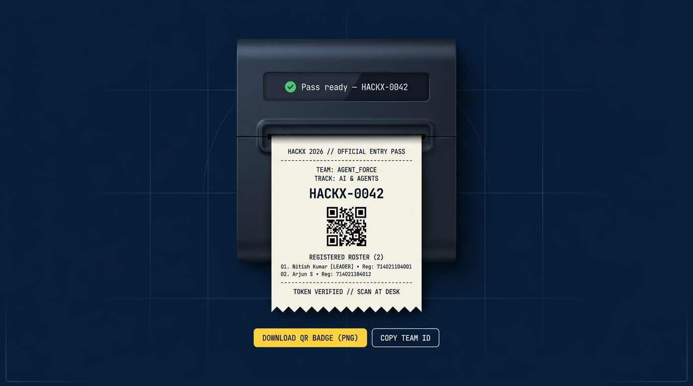

- **Route**: [`/register/success/[teamId]`](file:///d:/TEC/college/hackathon/app/register/success/[teamId]/page.tsx)
- **Access Level**: Public / Student (Verified against Team ID)
- **Key Features & Capabilities**:
  - **Physical Hardware Simulation**: Matte dark hardware chassis with highlight bevels, an OLED screen showing real-time printing status, and an SVG noise texture (`public/textures/plastic-noise.svg`).
  - **Stepped Thermal Feed Animation**: 20-keyframe stepped paper feed over 1.75 seconds onto warm cream 40-tooth serrated paper (`public/textures/receipt-paper.svg`).
  - **High-Contrast QR Entry Badge**: Encodes `hx_chk_` signed payload containing Team ID, Event ID, and member verification tokens.
  - **Printed Receipt Data**:
    - Event Header & Date
    - Team Name & Assigned Track
    - Sequential Team ID
    - Numbered Member Roster (with `[LEADER]` tag, Year, and Register Number)
    - Checksum Barcode
  - **Action Controls**:
    - **Reprint**: Replays the physical thermal feed animation on demand.
    - **Download QR Badge (PNG)**: Renders the ticket to an off-screen canvas and downloads a crisp PNG badge to the student's device.
    - **Copy Team ID**: Quick clipboard utility.
    - **Print**: Triggers clean `@media print` styles for physical paper printing.

---

### 4. Pass Retrieval & Lookup (`/find-registration`)

A self-service recovery page for participants who misplaced their Team ID or QR code pass.

- **Route**: [`/find-registration`](file:///d:/TEC/college/hackathon/app/find-registration/page.tsx)
- **Access Level**: Public
- **Key Features**:
  - Search by either **Team ID** (`HACKX-0001`) or the **Leader's Registered Email Address**.
  - Secure lookup API (`/api/public/team-lookup`) returns minimal public verification data.
  - One-click redirection straight back to the team's live Thermal Receipt Pass (`/register/success/[teamId]`).
  - Eliminates organizer desk bottlenecks caused by lost tickets on event morning.

---

### 5. Camera QR Check-In Desk (`/checkin`)

A fast, purpose-built camera scanner for front-desk volunteers and organizers during participant arrival.

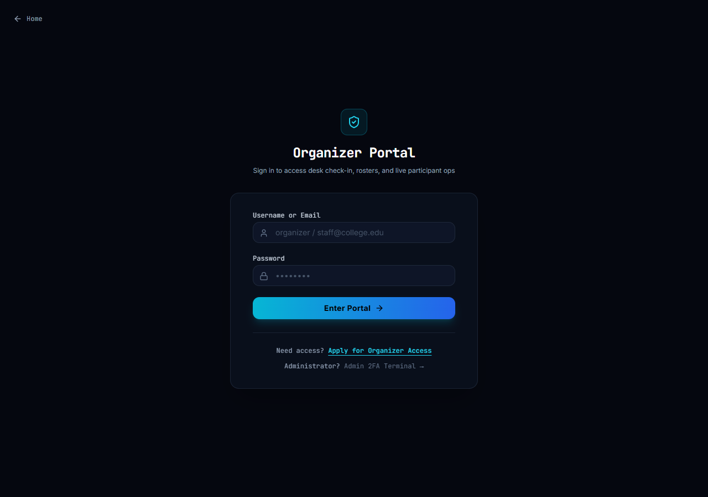

- **Route**: [`/checkin`](file:///d:/TEC/college/hackathon/app/checkin/page.tsx)
- **Access Level**: Protected (Approved Organizers with `checkin` permission & Root Admins)
- **Key Features & Capabilities**:
  - **Camera QR Scanner (`html5-qrcode`)**: High-framerate camera feed with live targeting reticle. Supports toggling between Rear (environment) and Front (user) cameras.
  - **Instant QR Decoding**: Decodes the `hx_chk_` token and queries `/api/checkin/lookup` in under 200ms.
  - **Member-by-Member Attendance**: Populates the full team roster with individual attendance checkboxes, allowing partial check-ins if a teammate is arriving later.
  - **Swag & Food Verification**: Displays whether badges and meals have been issued.
  - **Audio & Visual Feedback**: Plays an audio confirmation chime and flashes status banners on successful check-in.
  - **Manual Fallback**: Quick text input to type in a Team ID directly if a student's phone screen is cracked or unreadable.
  - **Role-Aware Exit Navigation**: The exit button intelligently routes back to `/admin` for administrators or `/organizer` for student organizers.

---

### 6. Live Auditorium & Stage Display (`/live`)

A dedicated high-contrast dashboard formatted specifically for auditorium projectors and stage displays throughout the 24-hour hackathon.

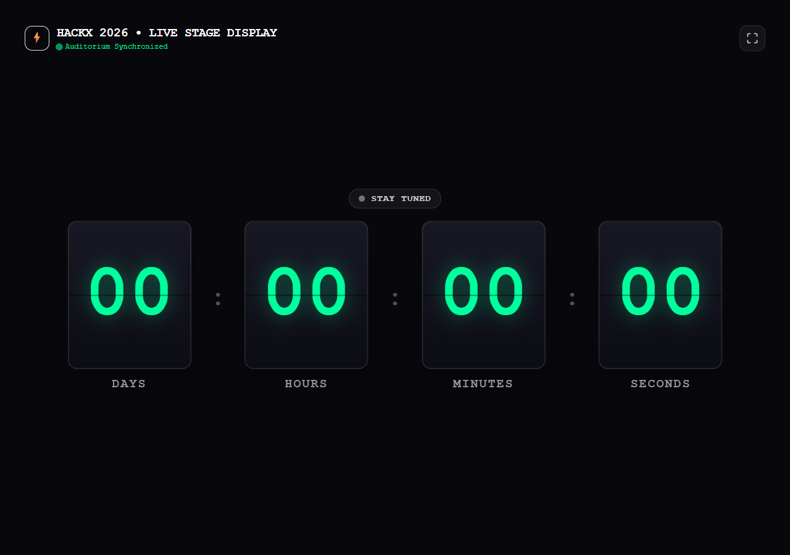

- **Route**: [`/live`](file:///d:/TEC/college/hackathon/app/live/page.tsx)
- **Access Level**: Public (Auditorium & Stage Screen Display)
- **Key Features & Capabilities**:
  - **Giant 3D Flip Clock (`FlipCountdown.tsx`)**: Mechanical flip card typography showing remaining Days, Hours, Minutes, and Seconds.
  - **Drift-Free Server-Offset Math (`lib/timer.ts`)**: Calculates drift against server timestamps so participants' or projector machines' skewed clocks do not cause countdown discrepancies.
  - **Emergency Broadcast Marquee (`AnnouncementTicker.tsx`)**: High-visibility ticker for mentor callouts, lunch/dinner alerts, API submission deadlines, and judging schedules.
  - **Stage Status Indicators**: Displays active hackathon phase (`HACKING IN PROGRESS`, `SUBMISSIONS CLOSED`, `JUDGING IN PROGRESS`).

---

### 7. Organizer Staff Portal (`/organizer/*`)

A dedicated operations portal for student volunteers, desk managers, and coordinators.

- **Routes**:
  - `/organizer/signup`: Self-registration page for volunteers. Automatically assigns `status: "pending"`.
  - `/organizer/login`: 8-hour HTTP-only session login.
  - `/organizer`: Staff dashboard showing active duties, assigned event, and quick links.
  - `/organizer/teams`: Paginated team roster with search and filter controls.
  - `/organizer/profile`: Personal profile and assigned duties.
- **Access Level**: Protected (Organizer Session)
- **Granular Role-Based Masking (`lib/permissions.ts`)**:
  - Volunteers assigned only to `checkin` can view team names and member rosters but **cannot** view raw personal phone numbers or email addresses (displayed as `j***@college.edu` and `+91 98****1234`).
  - Organizers with `viewContacts` permission unlocked by Admin can view full contact info to call team leads during emergencies.
  - Instant session invalidation: If an organizer is removed or permissions are updated, the admin increments `sessionVersion`, immediately terminating active JWT sessions.

---

### 8. Master Admin Operations Engine (`/admin/*`)

The central mission control suite providing full authority over the entire hackathon platform.

- **Route Suite**: [`/admin/*`](file:///d:/TEC/college/hackathon/app/admin/)
- **Access Level**: Root Admin Only (Master Password + RFC 6238 TOTP 2FA)
- **Sub-Panels & Capabilities**:
  1. **Initial Setup (`/admin/setup`)**: Permanent one-time enrollment screen that displays an Authenticator QR code. Once enrolled in MongoDB, this route permanently locks and redirects to login.
  2. **Admin Login (`/admin/login`)**: Authenticates via master username, password (`bcryptjs`), and 6-digit TOTP code (`otplib`) for an 8-hour session.
  3. **Dashboard (`/admin`)**: Real-time telemetry: total teams, checked-in students, gate velocity, and track distributions.
  4. **Editions Manager (`/admin/editions`)**: One-click edition cloning (`HackX 2026` &rarr; `HackX 2027`) and edition activation enforcing the single-active invariant.
  5. **Branding & Layout (`/admin/branding`)**: Toggle any of the 13 public landing page sections on or off with instant live updates.
  6. **Content Manager (`/admin/content`)**: Edit hero copy, event tagline, manifesto, venue address, and rules.
  7. **Tracks Editor (`/admin/tracks`)**: Drag-and-drop `@dnd-kit` editor for track icons, problem statements, and tags.
  8. **Prizes & Perks (`/admin/prizes`)**: Configure 1st, 2nd, 3rd podium cash prizes, track prizes, and student perks.
  9. **Schedule Timeline (`/admin/schedule`)**: Day-by-day milestone editor with time badges, locations, and descriptions.
  10. **Coordinators (`/admin/coordinators`)**: Faculty and student lead directory with Cloudinary photo uploads and category tags.
  11. **Organizers & Volunteers (`/admin/organizers`)**: Review pending volunteer requests, assign duties (`Desk Lead`, `Food`, `Judging`), toggle permissions (`checkin`, `viewTeams`, `viewContacts`), or revoke access.
  12. **Team Registrations (`/admin/registrations`)**: Master directory with search, track filters, attendance badges, full CSV export, and a **1,100ms Hold-to-Confirm Button** for safe team deletion.
  13. **Sponsors Grid (`/admin/sponsors`)**: Tiered sponsor editor (`Title`, `Platinum`, `Gold`, `Community`) with direct Cloudinary logo uploading.
  14. **Gallery Photos (`/admin/gallery`)**: Event photo contact sheet manager.
  15. **FAQ Accordion (`/admin/faqs`)**: Question and answer editor.
  16. **Live Announcements (`/admin/announcements`)**: Broadcast urgent alerts to `/` and `/live` tickers.
  17. **Timer Controller (`/admin/timer`)**: Set hackathon start time, hacking end time, and countdown state.
  18. **Security & Audit Logs (`/admin/security`)**: View recent login attempts, IP addresses, user agents, and 2FA verification logs.

---

## 🛡️ Role-Based Access Control (RBAC) Matrix

| Capability / Route | Public Visitor | Registered Participant | Pending Organizer | Staff Organizer | Desk Lead | Master Admin |
|:---|:---:|:---:|:---:|:---:|:---:|:---:|
| Browse Landing Page (`/`) | ✅ | ✅ | ✅ | ✅ | ✅ | ✅ |
| Register Team (`/register`) | ✅ | ✅ | ✅ | ✅ | ✅ | ✅ |
| View Thermal Receipt Pass (`/register/success/[id]`) | ✅ | ✅ | ✅ | ✅ | ✅ | ✅ |
| Lookup Lost Pass (`/find-registration`) | ✅ | ✅ | ✅ | ✅ | ✅ | ✅ |
| View Auditorium Clock (`/live`) | ✅ | ✅ | ✅ | ✅ | ✅ | ✅ |
| Organizer Dashboard (`/organizer`) | ❌ | ❌ | ❌ | ✅ | ✅ | ✅ |
| Access QR Camera Scanner (`/checkin`) | ❌ | ❌ | ❌ | Conditional (`checkin: true`) | ✅ | ✅ |
| View Team Roster (`/organizer/teams`) | ❌ | ❌ | ❌ | Conditional (`viewTeams: true`) | ✅ | ✅ |
| View Raw Participant Phone & Email | ❌ | ❌ | ❌ | ❌ (Masked) | Conditional (`viewContacts: true`) | ✅ (Unmasked) |
| Manage Event CMS, Tracks & Schedule | ❌ | ❌ | ❌ | ❌ | ❌ | ✅ |
| Clone & Activate Yearly Editions | ❌ | ❌ | ❌ | ❌ | ❌ | ✅ |
| Approve / Revoke Organizer Accounts | ❌ | ❌ | ❌ | ❌ | ❌ | ✅ |
| Export Team Data to CSV | ❌ | ❌ | ❌ | ❌ | ❌ | ✅ |
| Delete Team (1100ms Hold-to-Confirm) | ❌ | ❌ | ❌ | ❌ | ❌ | ✅ |
| Root Setup & 2FA Configuration | ❌ | ❌ | ❌ | ❌ | ❌ | ✅ (One-Time) |

---

## 🛠️ Technical Stack & Zero-Cost Serverless Setup

- **Framework**: [Next.js 14](https://nextjs.org/) (`14.2.20` App Router, React Server Components, Route Handlers)
- **Language**: [TypeScript 5](https://www.typescriptlang.org/) (`5.7.2`, strict mode)
- **Styling**: [Tailwind CSS](https://tailwindcss.com/) (`3.4.16`) with Blueprint design tokens + SVG grain shaders
- **Animation Suite**:
  - `gsap` (`3.15.1`) + `@gsap/react` (`2.1.2`) for scrubbed timeline spines, split typography, and scroll choreography
  - `framer-motion` (`11.15.0`) for skeuomorphic thermal receipt feed physics, morphing buttons, and spring feedback
- **Database**: [MongoDB Atlas](https://www.mongodb.com/atlas) via [Mongoose 8](https://mongoosejs.com/) (`8.8.4`)
- **Authentication & Cryptography**:
  - `jose` (`5.9.6`): Edge-compatible JWT signing and verification
  - `bcryptjs` (`2.4.3`): Salted master password hashing
  - `otplib` (`12.0.1`): RFC 6238 TOTP authenticator generation and verification
  - `qrcode` (`1.5.4`): QR generation for 2FA enrollment and entry passes
- **QR Code Scanner**: [html5-qrcode](https://github.com/mebjas/html5-qrcode) (`2.3.8`) with dual camera controls
- **Admin UI Utilities**:
  - `@dnd-kit/core` & `@dnd-kit/sortable` for drag-and-drop track and sponsor ordering
  - `recharts` (`2.15.0`) for telemetry charts
  - `sonner` (`1.7.1`) for stacked toasts
  - `lucide-react` (`0.468.0`) for CAD icons
- **Form Handling**: `react-hook-form` (`7.54.0`) + `zod` (`3.24.1`)
- **Asset Storage**: [Cloudinary](https://cloudinary.com/) Free Tier (`2.5.1`) with client-side image compression before upload
- **Hosting**: [Vercel](https://vercel.com/) Hobby Tier (Zero-cost serverless execution)

---

## 📁 Project Directory Structure

```text
├── app/
│   ├── layout.tsx                # Root layout with Blueprint theme-color & fonts
│   ├── page.tsx                  # Public landing page (13 configurable sections)
│   ├── globals.css               # Blueprint variables, reduced-motion rules & scroll styles
│   ├── live/                     # Stage projector 3D flip clock & broadcast display
│   ├── register/                 # Team registration form
│   │   └── success/[teamId]/     # Thermal Receipt Printer QR entry pass
│   ├── checkin/                  # Volunteer camera QR scanner & manual desk lookup
│   ├── find-registration/        # Participant self-serve QR pass recovery
│   ├── organizer/                # Staff portal (login, signup, dashboard, masked teams)
│   ├── admin/                    # Master admin portal
│   │   ├── setup/                # One-time root 2FA TOTP enrollment
│   │   ├── login/                # 2FA password & TOTP login
│   │   └── (panel)/              # 16 CMS sub-panels (editions, tracks, prizes, teams, etc.)
│   └── api/                      # Public, Checkin, Organizer, and Admin API route handlers
├── components/
│   ├── admin/                    # Drag-and-drop ListEditor, ImageUpload, CMS forms
│   ├── public/                   # Hero, About, Tracks, Schedule, Prizes, Coordinators,
│   │                             # Organizers, Sponsors, Gallery, Faq, Venue, Footer,
│   │                             # AnnouncementTicker, BlueprintBackground, FlipCountdown
│   └── shared/                   # ReceiptPrinter, DynamicButton, HoldToConfirmButton,
│                                 # ScrambleText, ScrollFadeList, CheckinScanner
├── helpers/
│   └── classname-helper.ts       # clsx + tailwind-merge (cn helper)
├── lib/
│   ├── activeEvent.ts            # Active edition cache & resolver
│   ├── auth.ts                   # Jose JWT signing, verification & production guards
│   ├── cloudinary.ts             # Cloudinary asset upload helper
│   ├── compressImage.ts          # Client-side image compression
│   ├── csv.ts                    # Admin team CSV export generator
│   ├── db.ts                     # Cached global Mongoose connection for serverless
│   ├── gsap.ts                   # SSR-safe GSAP plugin registry & reduced-motion helper
│   ├── mailer.ts                 # SMTP notification service
│   ├── permissions.ts            # Organizer RBAC checks & phone/email masking
│   ├── rateLimit.ts              # In-memory sliding-window rate limiter
│   ├── timer.ts                  # Server-offset drift-free countdown math
│   └── totp.ts                   # RFC 6238 authenticator setup & verification
├── models/                       # Mongoose Schemas (Admin, Event, Team, Organizer, etc.)
├── public/
│   ├── docs/images/              # Documentation screenshots & architecture mockups
│   ├── textures/                 # plastic-noise.svg & receipt-paper.svg shaders
│   ├── favicon.ico, og-image.png # Favicons, OpenGraph card & site.webmanifest
│   └── robots.txt, sitemap.xml   # Technical SEO crawlers & XML sitemap
└── scripts/
    └── seed.ts                   # Demo dataset generator (HackX 2026 edition)
```

---

## 🚀 Getting Started & Local Setup

### 1. Prerequisites
- **Node.js**: 18.17+ or 20+ LTS
- **Package Manager**: `pnpm` (recommended), `npm`, or `yarn`
- **MongoDB**: Free MongoDB Atlas cluster or local MongoDB instance
- **Cloudinary**: Free Cloudinary account (for image uploads)

### 2. Clone and Install Dependencies
```bash
git clone https://github.com/Sargonitish/nextgenhackathonwebsite.git
cd nextgenhackathonwebsite
pnpm install
```

### 3. Configure Environment Variables
Copy the example environment template:
```bash
cp .env.example .env.local
```

Edit `.env.local` with your credentials:
```env
# MongoDB Atlas Connection URI
MONGODB_URI=mongodb+srv://<username>:<password>@cluster0.xxxxx.mongodb.net/hackathon?retryWrites=true&w=majority

# JWT Encryption Secret (minimum 32 characters)
JWT_SECRET=your-random-secret-key-at-least-32-characters-long

# Public Site URL
NEXT_PUBLIC_SITE_URL=http://localhost:3000

# Cloudinary CDN Credentials (for image & logo uploads)
CLOUDINARY_CLOUD_NAME=your_cloud_name
CLOUDINARY_API_KEY=your_api_key
CLOUDINARY_API_SECRET=your_api_secret

# Optional: SMTP Email Alerts for organizer registrations
SMTP_HOST=smtp.gmail.com
SMTP_PORT=465
SMTP_USER=your_email@gmail.com
SMTP_PASS=your_app_specific_password
ADMIN_NOTIFY_EMAIL=admin@college.edu
```

### 4. Seed Demo Data
Populate MongoDB with a complete, fully fleshed out `HackX 2026` edition containing tracks, schedule, prizes, coordinators, and FAQs:
```bash
pnpm run seed
```

### 5. Launch Development Server
```bash
pnpm run dev
```
Open [http://localhost:3000](http://localhost:3000) in your browser.

---

## 🔐 Administrator Enrollment Runbook

Follow this one-time runbook to claim root administrative access:

1. **Initial Setup**: Open [http://localhost:3000/admin/setup](http://localhost:3000/admin/setup) in your browser.
2. **Create Root Credentials**: Enter your desired administrator username and master password.
3. **Scan 2FA TOTP QR Code**: Open your authenticator app (**Google Authenticator**, **1Password**, or **Aegis**) and scan the displayed QR code.
4. **Confirm TOTP Code**: Enter the 6-digit verification code from your authenticator to lock the account.
5. **Security Lock**: Once the admin record is written to MongoDB, `/admin/setup` permanently locks and automatically redirects to `/admin/login`.
6. **Logging In**: Visit [http://localhost:3000/admin/login](http://localhost:3000/admin/login), enter your username, password, and current 6-digit TOTP code for an 8-hour session.

---

## ☁️ Zero-Cost Production Deployment (Vercel & MongoDB Atlas)

1. **Database (MongoDB Atlas)**:
   - Create a free **M0 Sandbox** cluster on [MongoDB Atlas](https://www.mongodb.com/atlas).
   - In **Network Access**, allow access from `0.0.0.0/0` (required for Vercel serverless functions).
   - In **Database Access**, create a database user and copy the connection string.

2. **Asset CDN (Cloudinary)**:
   - Create a free account on [Cloudinary](https://cloudinary.com/).
   - Copy your `Cloud Name`, `API Key`, and `API Secret` from your dashboard.

3. **Deploy to Vercel**:
   - Push your repository to GitHub.
   - Go to [Vercel](https://vercel.com/) &rarr; Click **Add New Project** &rarr; Import your repository.
   - In **Environment Variables**, add all keys from `.env.local`:
     - `MONGODB_URI`
     - `JWT_SECRET`
     - `NEXT_PUBLIC_SITE_URL` (set to your live Vercel domain, e.g. `https://marvelzhack.vercel.app`)
     - `CLOUDINARY_CLOUD_NAME`, `CLOUDINARY_API_KEY`, `CLOUDINARY_API_SECRET`
   - Click **Deploy**.

4. **Complete Production Enrollment**:
   - Visit `https://your-domain.vercel.app/admin/setup` immediately after deployment to enroll your root 2FA authenticator.

---

## 📄 License & Author

Distributed under the **MIT License**. See `LICENSE` for details.

Engineered with pride by **Nitish** for collegiate hackathons, developer festivals, and student welfare.
